# Database & System Design Guide

This document explains the data model, the architectural decisions, and why the database is structured this way. Stack: ASP.NET Core + EF Core + PostgreSQL (hosted on Supabase) + Cloudinary.

---

## 1. Core Architectural Concepts

### A. The Entity-Attribute-Value (EAV) Pattern

Normally every piece of user information is a column:
`Users: [Id, Email, FirstName, LastName, Age, IELTSScore, FavoriteLanguage, ...]`

**Why doesn't this work here?**
* Recruiters must be able to define new attributes at any time (e.g., "Certified Analytics Professional").
* The specification forbids generating tables in the database on the fly.
* With 1,000 attributes, most candidates fill about 10, leaving 990 `NULL` columns (the sparse table problem).

**How EAV solves this**
1. **AttributeDefinitions** stores what an attribute *is* (`Name`, `DataType`, `Category`, `IsBuiltIn`).
2. **UserAttributeValues** stores the candidate's answer, one row per (user, attribute):

```
UserId   | AttributeId | Value
---------------------------------
user_123 | attr_001    | John
user_123 | attr_002    | 7.5
user_123 | attr_003    | 12        <- id of the option "Expert"
```

* Adding 100 new attributes tomorrow needs **zero migrations**.
* Built-in attributes (First Name, Last Name, Location, Personal Photo) use this same table with `IsBuiltIn = true`. The CV engine treats them like every other attribute, with no special if/else. **Do not** also store names or photos as columns on the user table, because that creates two sources of truth.
* Renaming an attribute keeps all values, because they point to the attribute's ID, not its name.

**Canonical value formats.** `Value` is a text column, so every data type must be saved in one fixed format. Otherwise comparisons break (as text, `"10" < "9"`, and `7,5` differs from `7.5` by culture).

| DataType | Saved in `Value` as | Example |
|---|---|---|
| String / Text | the text as entered | `Python developer` |
| Numeric | invariant-culture decimal, dot separator | `7.5` |
| Date | ISO `yyyy-MM-dd` | `2026-09-23` |
| Period | `start/end` in ISO, end empty if ongoing | `2024-01-01/2024-06-30` |
| Boolean | `true` or `false` | `true` |
| OneOfMany | the `AttributeOption.Id` as text | `12` |
| Image | the Cloudinary URL (the public ID goes in `ImagePublicId`) | `https://res.cloudinary.com/...` |

Parse values in C# using the attribute's `DataType` and `CultureInfo.InvariantCulture`.

---

### B. The "Virtual CV" Architecture

The `Cvs` table has **no columns for CV text or skills**:

```
Cvs: [Id, UserId, PositionId, State (Draft/Published), Version, CreatedAt, UpdatedAt]
```

**Why?** The architecture requires the CV to be **virtual**: it is assembled on every read. When someone opens a CV for "Junior Data Engineer", the API runs a fixed number of queries (never one per attribute):
1. Load the **Position** template with its attribute list and project tags.
2. Load the candidate's rows from `UserAttributeValues` for those attributes **plus the built-in Me attributes**, in one query.
3. Load the candidate's **Projects** that share a tag with the position, most recent first, limited to `Position.MaxProjects`.
4. Merge everything into a response DTO. The DTO is only an API response and is **never stored** (CVs are never stored as static JSON).

Consequences:
* If a candidate edits their profile, every CV shows the change immediately.
* If a value is missing, the API returns an empty placeholder and the frontend highlights it in **red**.
* Editing a value inside a CV writes to `UserAttributeValues`, so it changes the profile everywhere.
* Publishing is allowed only if every attribute has a value. The server checks this again; do not rely only on the UI.
* If the candidate no longer passes the position's access rules, the CV is hidden (checked at read time).

---

### C. Optimistic Locking

Prevents two users (or two browser tabs) from silently overwriting each other.

1. `AppUser`, `AttributeDefinition`, `Position`, `Cv`, and `Project` each have an integer `Version` configured as a concurrency token (`IsConcurrencyToken()`).
2. The client receives `version: 1` when it loads a record and sends it back when saving.
3. The server sets `OriginalValue` to the client's version and increments `Version`. EF Core adds `WHERE Version = 1` to the UPDATE.
4. If someone saved first, zero rows match and EF throws `DbUpdateConcurrencyException`. The API returns `409 Conflict`, and the UI offers to reload.

**Two gotchas to design for**

* **The token only protects the row you actually update.** If you change only child rows (position attributes, access rules, tags, attribute values), EF does not touch the parent row, so no conflict is detected. Always increment the parent's `Version` in the same `SaveChanges`:

| You change | Bump this `Version` |
|---|---|
| Profile values (Me, Info, or an in-place edit inside a CV) | `AppUser.Version` |
| A position's attributes, tags, or access rules | `Position.Version` |
| An attribute's options | `AttributeDefinition.Version` |
| CV state (Publish) | `Cv.Version` |

* **Bookkeeping updates must not bump the version.** Writing `LastUsedAt` (or a language/theme preference) would cause false conflicts. Update those with `ExecuteUpdateAsync` and leave `Version` alone.

---

### D. Users, Roles, and Login (Supabase Auth + JWT Bearer)

* **Supabase** handles OAuth logins (Google, GitHub, Facebook) on the frontend via `@supabase/supabase-js`.
* `AppUser.Id` is the Supabase Auth User ID (a UUID string matching the JWT's `sub` claim).
* The ASP.NET Core Web API validates the Supabase JWT using `Microsoft.AspNetCore.Authentication.JwtBearer` (verifying the Supabase authority and audience `authenticated`).
* **Roles** live in an `AppUserRole` table (`UserId`, `Role`). Admins can assign and remove roles (Candidate, Recruiter, Administrator) for any user, and may remove their own Administrator role. A user can hold multiple roles (e.g. both Recruiter and Administrator). When a new user logs in for the first time, they are auto-provisioned with the `Candidate` role.
* `IsBlocked` is checked on every request, so blocking takes effect immediately (returning `403 Forbidden`).

---

## 2. Entity Relationship Diagram

```mermaid
erDiagram
    AppUser ||--o{ AppUserRole : "holds"
    AppUser ||--o{ UserAttributeValue : "has"
    AppUser ||--o{ Project : "owns"
    AppUser ||--o{ Cv : "creates"
    AppUser ||--o{ DiscussionPost : "writes"
    AppUser ||--o{ Like : "gives"

    Category ||--o{ AttributeDefinition : "groups"
    AttributeDefinition ||--o{ AttributeOption : "has choices"
    AttributeDefinition ||--o{ UserAttributeValue : "defined by"
    AttributeDefinition ||--o{ PositionAttribute : "required in"
    AttributeDefinition ||--o{ PositionAccessRule : "filtered by"

    Position ||--o{ PositionAttribute : "requires"
    Position ||--o{ PositionTag : "filters by"
    Position ||--o{ PositionAccessRule : "restricts via"
    Position ||--o{ Cv : "template for"
    Position ||--o{ DiscussionPost : "hosts"

    Project ||--o{ ProjectTag : "tagged with"
    Tag ||--o{ ProjectTag : "assigned to"
    Tag ||--o{ PositionTag : "specified by"

    Cv ||--o{ Like : "receives"

    AppUser {
        string Id PK "Supabase Auth UUID"
        string Email
        boolean IsBlocked
        string PreferredLanguage "optional, saved UI language"
        string PreferredTheme "optional, light or dark"
        int Version "Concurrency Token"
        datetime CreatedAt
    }

    AppUserRole {
        string UserId PK, FK
        string Role PK "Candidate | Recruiter | Administrator"
    }

    Category {
        int Id PK
        string Name "e.g. Certification, Domain Knowledge"
    }

    AttributeDefinition {
        int Id PK
        string Name
        string NormalizedName UK "lowercase and trimmed, globally unique"
        string Description
        enum DataType "String | Text | Image | Numeric | Date | Period | Boolean | OneOfMany"
        int CategoryId FK
        boolean IsBuiltIn "True for First Name, Photo, etc."
        datetime LastUsedAt "For recently used lookup"
        int Version "Concurrency Token"
    }

    AttributeOption {
        int Id PK
        int AttributeDefinitionId FK
        string Label "e.g. Essentials, Pro, Expert"
        int SortOrder
    }

    UserAttributeValue {
        string UserId PK, FK
        int AttributeDefinitionId PK, FK
        string Value "Canonical text format, see section 1A"
        string ImagePublicId "Cloudinary id, only for Image type"
        datetime UpdatedAt
    }

    Project {
        int Id PK
        string UserId FK
        string Name
        date StartDate
        date EndDate "Null if ongoing"
        string Description "Markdown"
        int Version "Concurrency Token"
    }

    Tag {
        int Id PK
        string Name "Display form, e.g. React"
        string NormalizedName UK "lowercase, prevents React vs react"
    }

    ProjectTag {
        int ProjectId PK, FK
        int TagId PK, FK
    }

    Position {
        int Id PK
        string Title
        string ShortDescription
        boolean IsPublic
        int MaxProjects "Max projects to display in CV"
        int Version "Concurrency Token"
        datetime CreatedAt
        datetime UpdatedAt
    }

    PositionAttribute {
        int PositionId PK, FK
        int AttributeDefinitionId PK, FK
        int SortOrder "Order of fields in the CV"
    }

    PositionTag {
        int PositionId PK, FK
        int TagId PK, FK
    }

    PositionAccessRule {
        int Id PK
        int PositionId FK
        int AttributeDefinitionId FK
        enum Operator "See section 5"
        string TargetValue "Canonical text format"
    }

    Cv {
        int Id PK
        string UserId FK
        int PositionId FK
        enum State "Draft | Published"
        int Version "Concurrency Token"
        datetime CreatedAt
        datetime UpdatedAt
    }

    DiscussionPost {
        int Id PK
        int PositionId FK
        string AuthorUserId FK
        string Content "Markdown"
        datetime CreatedAt
    }

    Like {
        int CvId PK, FK
        string RecruiterUserId PK, FK
        datetime CreatedAt
    }
```



Store all timestamps in **UTC** (`timestamptz`). Npgsql rejects `DateTime` values whose `Kind` is `Unspecified`, so use `DateTime.UtcNow`.

---

## 3. Constraints & Indexes

EF Core creates an index for each foreign key automatically. These are the extra ones you must add.

| Table | Constraint / index | Why |
|---|---|---|
| UserAttributeValue | PK (`UserId`, `AttributeDefinitionId`) | one value per user per attribute |
| Cv | UNIQUE (`UserId`, `PositionId`) | at most one CV per position |
| Like | PK (`CvId`, `RecruiterUserId`) | one like per recruiter per CV |
| PositionAttribute, PositionTag, ProjectTag | composite PK | no duplicates |
| AttributeOption | UNIQUE (`AttributeDefinitionId`, `Label`) | no duplicate choices |
| AttributeDefinition | UNIQUE `NormalizedName` | globally unique names, case-insensitive |
| AttributeDefinition | index `NormalizedName` with `text_pattern_ops` | fast **prefix** lookup (`StartsWith`) |
| AttributeDefinition | index `CategoryId`, index `LastUsedAt` | category filter, recently used |
| Tag | UNIQUE `NormalizedName` (also `text_pattern_ops`) | tag autocomplete |
| Position | index `UpdatedAt`, index `CreatedAt` | "Latest Positions" |
| Cv | index (`PositionId`, `State`) | "Most Popular" and submitted CV counts |
| Cv | index `CreatedAt` | "CVs in the last 24 hours" |
| DiscussionPost | index (`PositionId`, `Id`) | polling for posts after the last seen ID |
| Project | index (`UserId`, `StartDate`) | recent projects for the CV |

In EF Core, the prefix index is `HasIndex(x => x.NormalizedName).HasOperators("text_pattern_ops")`.

---

## 4. Cascade Deletes

Relationships use foreign keys with **Cascade Delete** (`OnDelete(DeleteBehavior.Cascade)`) unless noted. PostgreSQL has no "multiple cascade paths" restriction, so overlapping paths are fine.

| When you delete... | ...the database also removes | Notes |
|---|---|---|
| **Position** | its attributes, tags, access rules, discussion posts, and CVs (and those CVs' likes) | |
| **AttributeDefinition** | its options, all users' values for it, its position links and access rules | The UI must warn first (see section 5) |
| **AppUser** | their values, projects (and project tags), CVs (and likes), posts they wrote, likes they gave | |
| **Cv** | its likes | |
| **Project** | its project tags | |
| **Tag** | its project and position links | |
| **Category** | **nothing: use `Restrict`** | A cascade here would delete every attribute in the category. Categories are seeded and have no UI. |
| **AttributeOption** | nothing | Values store the option ID as text, so there is no foreign key. Before deleting an option, check in one query whether any `UserAttributeValue` uses it, and refuse if so. |

**Why?** Writing C# loops like `foreach (var cv in position.Cvs) { db.Cvs.Remove(cv); }` is slow, breaks on network timeouts (partial deletion), and violates database performance constraints.

---

## 5. Access Rules

* `IsPublic = true`: every logged-in Candidate can use the position.
* `IsPublic = false`: the candidate must satisfy **all** rules (AND). A missing value fails the rule.
* Do not allow saving a non-public position with **zero** rules. It would be unclear who can see it. This also matters because deleting an attribute cascades to its rules, so the UI should list affected positions before confirming.
* Recruiters and Administrators are not limited by access rules.
* **How to check:** load the candidate's values in one query, load positions with their rules in another, and evaluate in C# by parsing values with the attribute's `DataType`. No queries inside loops.

Available operators depend on the data type:

| DataType | Operators |
|---|---|
| Numeric | `Equals`, `NotEquals`, `GreaterThan`, `GreaterOrEqual`, `LessThan`, `LessOrEqual` |
| String / Text | `Equals`, `NotEquals`, `Contains` |
| Date | `Equals`, `Before`, `After` |
| Boolean | `IsChecked`, `IsNotChecked` |
| OneOfMany | `Equals`, `NotEquals` (target is an option ID) |
| Period, Image | not filterable |

---

## 6. Full-Text Search

Add generated `tsvector` columns with GIN indexes (`HasGeneratedTsVectorColumn(...)` plus `HasIndex(...).HasMethod("GIN")` in Npgsql EF Core):

* `Position`: `Title` + `ShortDescription`
* `Project`: `Name` + `Description`
* `UserAttributeValue`: `Value`

Query with `EF.Functions.ToTsVector(...).Matches(...)`. Tag names and user names come from a join. Recruiters only ever get Published CVs in results.